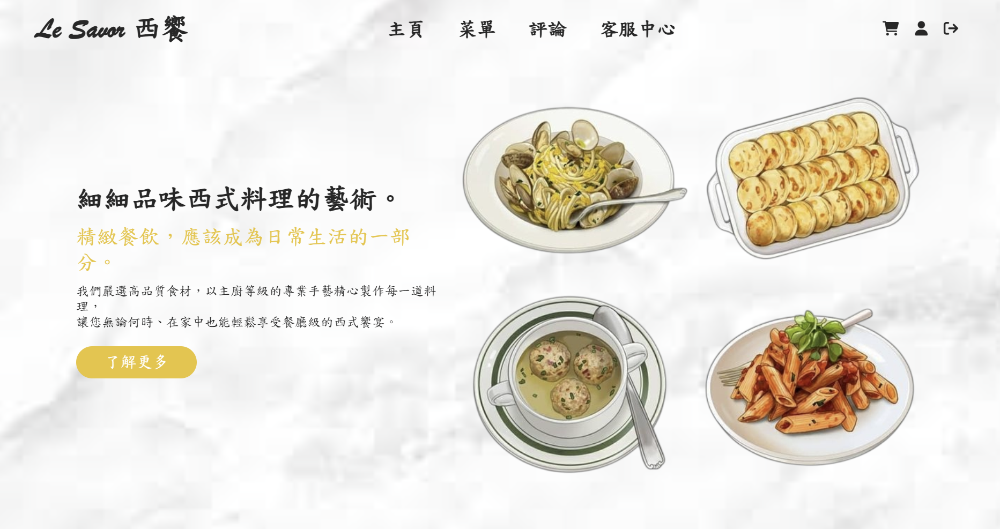

# 🍝 West Food Restaurant

一個提供使用者登入、商品瀏覽與管理功能的餐廳網站，  
具備登入功能、角色權限與後台管理概念。


## Demo 連結




## 功能介紹

- 使用者註冊 / 登入
- 密碼加密儲存（bcrypt）
- Navbar 依登入狀態切換
- 商品分類瀏覽
- 顧客評論
- 管理者後台
    - 使用者管理
    - 資料管理
    - 數據監測


## 使用技術

### Frontend
- Vue 3
- Pinia
- Vue Router
- Axios

### Backend
- Node.js
- Express
- MongoDB
- bcrypt

### Other
- Docker（尚未導入）

## 專案說明

- 本專案使用 `concurrently` 同時啟動前端與後端
- 後端使用 `bcrypt` 對使用者密碼進行雜湊處理，不以明文方式儲存


## 專案啟動方式

### 1. Clone 專案
```bash
git clone https://github.com/Clare0808/west-food-restaurant.git
```

### 2. 安裝套件

```bash
npm install
cd backend && npm install
```

### 3. 環境需求

- Node.js
- npm
- MongoDB

### 4. 環境變數設定

請在 backend 目錄下建立 `.env` 檔案：

```env
PORT=3000
MONGO_URL=mongodb://127.0.0.1:27017/west_food
JWT_SECRET=yourSecretKey
SESSION_SECRET=yourSessionSecret
GOOGLE_CLIENT_ID=yourGoogleClientId
GOOGLE_CLIENT_SECRET=yourGoogleClientSecret
GOOGLE_CALLBACK_URL=http://localhost:3000/api/auth/google/callback
```

### 5. 啟動專案

```bash
npm run start
```

從專案根目錄執行此指令會使用本機的 MongoDB (`127.0.0.1:27017`)；請先啟動 MongoDB。若 `backend/.env` 的 `MONGO_URL` 設為 Docker 專用的 `mongodb://mongo:27017/west_food`，單獨執行後端時需改用本機網址。

若要分開啟動 (選擇性) :

#### 前端

```bash
npm run serve
```

#### 後端
```bash
cd backend
npm run dev:local
```

若使用 Docker 網路中的 MongoDB，才在 `backend` 目錄執行 `npm run dev`（讀取 `.env` 中的 `MONGO_URL`）。
